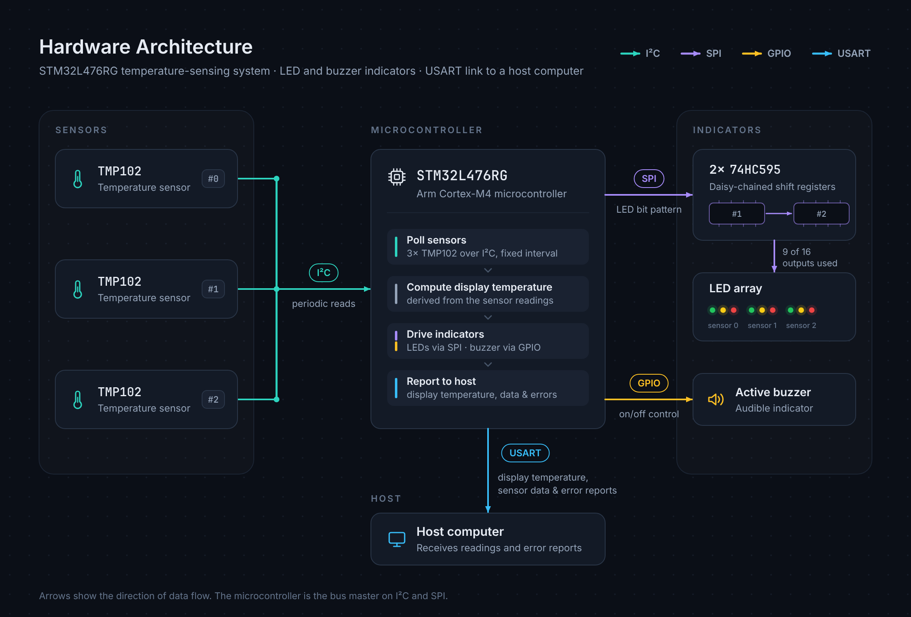

# Redundant Temperature Sensor System

A fault-tolerant temperature monitoring system built around an STM32L476RG microcontroller and three redundant TMP102 temperature sensors.

The system periodically reads the sensors, evaluates the readings for communication failures, out-of-range values, and disagreement between redundant measurements, and determines a final temperature value from the available valid readings.

Sensor status (and certain changes in sensor status) is communicated through LEDs and an active buzzer, while timestamped temperature and error information is transmitted to a host computer over USART.

---

## Overview

This project includes code for **a redundant temperature sensor system** to be run on an STM32L476RG microcontroller.

This system:

- Periodically samples multiple temperature sensors over a shared I²C bus, utilizing a timer interrupt.
- Detects sensor communication failures.
- Detects temperature measurements outside the sensor's specified operating range.
- Identifies measurements that deviate significantly from the other measurements received.
- Uses the results from the above analyses to determine a final display temperature.
- Drives status LEDs through a pair of 74HC595 shift registers.
- Activates an audible buzzer when sensor measurements are first flagged or go missing.
- Maintains a real-time clock (RTC) for timestamping measurements and errors.
- Communicates timestamped measurements and fault information to a host computer over USART.

The project serves as a demonstration of embedded C programming, peripheral communication, and redundant-sensor decision logic.

---

## Topics/Technologies Involved

- Embedded C
- STM32L4 microcontrollers
- STM32 HAL
- TMP102 temperature sensors
- I²C communication
- SPI communication
- USART communication
- RTC timestamping
- Timer interrupts
- USART receive interrupts
- Fault detection
- Redundant sensor processing
- CMake
- Ninja
- ARM GNU Toolchain
- Visual Studio Code
- Cortex-Debug
- ST-LINK
- Unity (C unit testing)
- Jasmine and Node.js (board-connected USART tests)
- GitHub Actions CI

---

## System Architecture

> **NOTE:** While the firmware logic that analyzes the temperature readings is designed to accommodate a variable number of temperature sensors, the default settings and code of the software overall expect 3 temperature sensors. This setup is used in the diagrams and explanations that follow.
> Adapting the complete system to another sensor count requires corresponding hardware and software changes. The astute engineer may discern how to do so.

The firmware is intended to run on an STM32L476RG microcontroller. TMP102 digital temperature sensors are connected to the microcontroller via a shared I2C bus and are intermittently polled after a timer interrupt sets a flag to do so during the next pass through the main function's while loop.

The received sensor readings are then analyzed by the firmware, and a final 'display temperature' is determined. Based on both the readings from the sensors and the results of the determination logic running on the microcontroller, LED indicators associated with each sensor are then updated, and data is sent to a host computer via a USART connection.

The following diagram visualizes connections between different physical components of the system.



---

## Hardware

### Main Components

- STM32 Nucleo-L476RG
- 3 × TMP102 temperature sensors
- 2 × 74HC595 shift registers
- Active buzzer
- Red, yellow, and green LEDs
- 220 Ω resistors
- USB / micro-USB connection to host computer

### Sensor Configuration

The default firmware configuration expects three TMP102 sensors using the following I²C addresses:

| Sensor   | TMP102 Address |
| -------- | -------------: |
| Sensor 0 |         `0x48` |
| Sensor 1 |         `0x49` |
| Sensor 2 |         `0x4A` |

The sensors share the same I²C bus.

For more information on TMP102 temperature sensors (including how to assign the above addresses to different sensors) feel free to explore the datasheet available on [this page](https://www.ti.com/product/TMP102) of Texas Instruments' website.

### Status LEDs

Each sensor has a red, yellow, and green status LED.

The current implementation uses the LEDs to indicate the sensor's state:

| Sensor condition                        | LED indication |
| --------------------------------------- | -------------- |
| Valid reading                           | Green          |
| Questionable / flagged reading          | Yellow         |
| Communication failure / missing reading | Red            |

The LEDs are controlled through daisy-chained 74HC595 shift registers using SPI.

### Buzzer

An active buzzer is used to provide an audible indication when certain sensor condition changes occur.

A short beep is generated when a sensor becomes newly faulty (experiences a communication failure, or has its reading flagged as being an outlier or out of the sensor's specified operating range). If all sensors become unavailable, the buzzer enters an extended/continuous alert state.

---

## Software Architecture

The firmware is divided into .c files inside of `Core/App/`, with the main.c file (initially generated by CubeMX, but edited by the author of this project) under `Core/Src/`, along with other STM generated or included .c files.

```text
Core/
├── App/
│   ├── alerts.c
│   ├── determination_logic.c
│   ├── hardware.c
│   ├── interrupt_handlers.c
│   ├── interrupts.c
│   ├── logging.c
│   ├── rtc.c
│   ├── sensor.c
│   └── usb_comm.c
│
├── Inc/
│   ├── alerts.h
│   ├── defines.h
│   ├── determination_logic.h
│   ├── error_codes.h
│   ├── faults.h
│   ├── hardware.h
│   ├── interrupt_handlers.h
│   ├── interrupts.h
│   ├── logging.h
│   ├── rtc.h
│   ├── sensor.h
│   ├── usb_comm.h
│   └── STM32/CubeMX-generated / included header files
│
└── Src/
    ├── main.c
    └── STM32/CubeMX-generated source
```

### High-Level Data Flow

```text
       TMP102 Sensors
       Sensor 0  ─┐
       Sensor 1  ─┼── I²C ──► Sensor Readings
       Sensor 2  ─┘                │
                                   ▼
                   Fault Detection & Redundancy Logic
                                   │
                    ┌──────────────┼──────────────┐
                    ▼              ▼              ▼
              Display Temp       LEDs          Buzzer
                    │
                    ▼
             Timestamp + Data
                    │
                    ▼
              USART / USB
                    │
                    ▼
             Host Computer
```

### Main-Loop / Interrupt Architecture

The timer and USART peripherals use interrupts, but substantial processing is intentionally performed outside the interrupt service routines.

The general execution model is:

```text
Sensor Polling Timer Interrupt
      │
      ▼
Set readNow flag
      │
      ▼
Main Loop
      │
      ├── Read sensors
      ├── Flag questionable / missing readings
      ├── Determine display temperature
      ├── Log data
      ├── Update LEDs / buzzer
      └── Prep for next sensor read
```

The main loop is also set to, on each iteration through the loop, check and handle flags set or errors logged during execution of interrupt code, as well as to check the state of the buzzer (a non-blocking way to turn off the buzzer after a certain amount of time has elapsed).

USART reception follows a similar pattern:

```text
USART Receive Interrupt
      │
      ▼
Receive bytes into buffer
      │
      └── If message terminator received or error occurs
      │                       │
      │                       ▼
      │         Set flags/errors based on message received or error that occurred
      │
      ▼
Main Loop
      │
      └── Check for and/or handle flags set or errors logged
```

This keeps relatively time-consuming operations such as sensor communication, logging, and received RTC data processing out of interrupt callbacks.

---

## Sensor Redundancy and Fault Detection

Each sensor is represented by a `Sensor` structure containing its I²C address, current (most recent) temperature reading value, fault flags, the previous reading's fault flags, and data associated with the LEDs related to that sensor's measurements.

The firmware evaluates sensor readings in several stages.

### 1. Communication Check

If an I²C communication fails, the sensor is marked with a communication fault:

```text
COMM_FAULT
```

Its current temperature is then treated as unavailable.

When an I²C HAL transmit or receive operation fails, the firmware retries the failed operation once. If the retry also fails, the affected sensor is marked with a `COMM_FAULT`. If the retry succeeds, normal processing continues.

Successful communication operations do not trigger unnecessary retries.

### 2. Outlier Detection

If more than one reading is available for consideration, then the available sensor readings are compared against one another.

If a reading's value differs from the current average by at least the configured disagreement threshold, it is marked as an outlier:

```text
IS_OUTLIER
```

The average is then recalculated using the remaining valid reading values.

This process continues until the remaining reading values no longer disagree beyond the configured threshold.

If this process removes all but one reading, the last reading is marked as an outlier as well (every reading then disagrees with every other), an `ALL_READS_MARKED_INVALID` error is reported, and the display temperature is chosen as described below.

Agreement between sensors is trusted over the sensors' specified operating range. Therefore, when two sensors agree with each other on a value outside of the sensors' specified operating range, disagreeing with a third reading that is within the sensors' specified range, then they will be trusted over the third, outlier value (even though they are out of bounds and the third is within the specified operating temperature bounds).

In such a case, the two agreeing readings would still be flagged by the bounds check as being out of the specified sensor operating bounds, but their average would still become the display temperature.

> **NOTE:** Outlier detection runs before readings are checked for being out of specified operating bounds, and it runs only when more than one reading is available.

### 3. Temperature Bounds

After outlier processing, every available reading (including readings already marked as outliers) is checked against the configured upper and lower temperature bounds (by default set to the manufacturer's specified operating range for the sensors). A reading can therefore carry both an outlier flag and a bounds flag.

Measurements outside those limits are marked with:

```text
ABOVE_BOUNDS
```

and

```text
BELOW_BOUNDS
```

respectively. Note that, since outlier processing only occurs if more than one reading value is available, yet even a single reading can be above or below the specified sensor operating range, this bounds-checking process occurs even if there is only one reading value available (and no outlier detection has occurred).

### 4. Final Temperature

In light of the results of the aforementioned analyses and the sensor readings available, a final display temperature is determined.

The firmware may:

- Average the readings that carry no fault flags (the normal case).
- Use the only available reading when just one sensor is communicating. The bounds check still runs on it, so the reading is displayed even if it is flagged as out of range.
- Choose one reading to display when all readings are outliers of each other. Specifically the last reading marked as an outlier will be selected, if that reading is also within the specified sensor operating range. Otherwise, the last reading marked as an outlier that is also within the sensor operating range will be selected. However, if none of the readings are within the specified sensor operating bounds, then the last reading marked as an outlier will still be selected, in spite of also being out of the specified operating range.
- Average agreeing readings that are outside the specified sensor operating range, if all in-bounds readings are marked as outliers (e.g. the two-agreeing-sensors case described in [Outlier Detection](#2-outlier-detection) above). In such a case, an `ALL_READS_MARKED_INVALID` error is reported with no sensor number.
- Return `NAN` when no sensor readings are available.

The exact determination logic is implemented in `determination_logic.c`.

---

## Fault Flags

Sensor faults are represented as a bitmask, allowing multiple fault conditions to be associated with the same sensor.

| Flag           | Meaning                                                           |
| -------------- | ----------------------------------------------------------------- |
| `COMM_FAULT`   | Communication with the sensor failed                              |
| `ABOVE_BOUNDS` | Temperature reading above the sensor's specified upper bound      |
| `BELOW_BOUNDS` | Temperature reading below the sensor's specified lower bound      |
| `IS_OUTLIER`   | Reading was rejected because it disagreed with the other readings |

Because these are bit flags, multiple faults can be simultaneously associated with one sensor (e.g. a reading can be both above bounds and an outlier).

---

## Communication Protocol

The program is set to communicate with a host computer via USART (USB) using a baud rate of 115200. The STM32's USART connection is exposed to the host computer through the Nucleo board's USB connection.

Messages can be sent either to or from the microcontroller. The only task currently intended to be done by sending data to the microcontroller is setting the RTC; see [Communication to the Microcontroller](#communication-to-the-microcontroller) later in this section.

### Communication From the Microcontroller

Messages sent from the microcontroller to a host computer via USART use the following general structure:

```text
<header><timestamp><message body>\r\n
```

The **header** consists of a letter identifying the type of message being transmitted, a colon, and a space. There are two different headers corresponding to the different message types:

- Data (`D: `)
- Error (`E: `)

#### Data Messages

Data messages begin with:

```text
D:
```

The message contains:

```text
D: timestamp, display temperature, sensor 0 temperature, sensor 1 temperature, sensor 2 temperature, sensor 0 faults, sensor 1 faults, sensor 2 faults
```

Example:

```text
D: 09/10/2026 10:42:18, 24.75, 24.75, 24.69, 24.81, , ,
```

A missing temperature is represented by:

```text
--.--
```

A description of the different pieces of information follows:

- Timestamp - The timestamp for the specific batch of data.
- Display Temperature - The temperature returned by the microcontroller logic after analyzing the available individual temperature sensor read values.
- Sensor Values - The temperature values (in degrees Celsius) derived from the readings of each temperature sensor, in sensor order (sensor 0, 1, 2), separated by commas. (If a reading was missing, the value is transmitted as "--.--").
- Sensor Faults - A string of symbols representing different 'faults' associated with each temperature sensor reading, in the same sensor order.

> **NOTE:** Sensor numbers in messages are 0-based: sensors 0, 1 and 2 are the sensors at `0x48`, `0x49` and `0x4A`, in that order (as in [Sensor Configuration](#sensor-configuration) above).

#### Fault Symbols

Sensor fault strings use the following symbols:

| Symbol  | Meaning                               |
| ------- | ------------------------------------- |
| `` ` `` | Communication / missing-reading fault |
| `*`     | Outlier                               |
| `-`     | Below configured temperature range    |
| `+`     | Above configured temperature range    |

Multiple symbols can appear together when a sensor has multiple fault flags. Or, a string of fault flags can simply be an empty string if no flags have been marked for that sensor reading.

#### Error Messages

Error messages begin with the error message header:

```text
E:
```

and include a timestamp followed by the error code (a unique three digit number enclosed in square brackets []) and a message describing the error or situation that occurred that led to the sending of the message. Some examples include:

```text
E: 09/10/2026 10:42:18 [201] Sensor 1 reading missing.
```

```text
E: 09/10/2026 10:42:20 [303] Sensor 2 reading marked invalid as an outlier.
```

```text
E: 09/10/2026 10:42:22 [200] All sensor readings missing.
```

They are also terminated by carriage return and newline characters. A table of different errors and their error codes is shown below.

| Error Code |                           Error |
| ---------- | ------------------------------: |
| 100        |          `SENSORS_NOT_DETECTED` |
| 200        |      `ALL_SENSOR_READS_MISSING` |
| 201        |           `SENSOR_READ_MISSING` |
| 300        |      `ALL_READS_MARKED_INVALID` |
| 301        |             `READ_ABOVE_BOUNDS` |
| 302        |             `READ_BELOW_BOUNDS` |
| 303        |        `READ_MARKED_AS_OUTLIER` |
| 400        |               `NOT_ENOUGH_LEDS` |
| 500        | `UNRECOGNIZED_COMMAND_RECEIVED` |
| 501        |          `RTC_FORMATTING_ERROR` |
| 502        |    `RTC_INVALID_DATETIME_ERROR` |
| 503        |                 `RTC_SET_ERROR` |
| 504        |                `RX_BUFFER_FULL` |
| 505        |            `RX_BUFFER_OVERFLOW` |
| 999        |   `UNRECOGNIZED_ERROR_RECEIVED` |

### Communication to the Microcontroller

#### Receive Buffer Behavior

The firmware maintains a single pending received message. If a complete message has not yet been processed by the time another message is fully received, the additional message is discarded and an `RX_BUFFER_FULL` error is reported, along with a request for the message to be resent.

Messages exceeding the receive buffer size generate an `RX_BUFFER_OVERFLOW` error. Once the maximum number of characters have been received (by default 100 characters) without having received the terminating `\n`, the error is generated, the buffer is reset, and any remaining bytes are then processed as being part of a new message.

Messages are terminated by a LF (`\n`), which is included in the count towards the 100 max character limit for messages. CR (`\r`) characters are ignored (and do not count towards the 100 max character limit for messages), allowing either LF (`\n`) or CRLF (`\r\n`) line endings to terminate a message.

Messages that are not recognized as a valid command generate an `UNRECOGNIZED_COMMAND_RECEIVED` error, unless the system is in a state expecting to receive date/time data via USART, in which case different errors are logged if the data is considered invalid or incorrectly formatted in light of what the system is expecting.

The only command the firmware has currently been set up to recognize and handle via USART is setting the microcontroller's RTC, the process of which is explained below.

#### Initial Setting of the RTC Via USART Communication

The microcontroller will send a "`SEND_TIME\r\n`" message before entering normal operation. After this message is sent, the next received message is interpreted as the date/time value. The expected format is:

```text
YYYY/mm/dd HH:MM:SS
```

using 24-hour time.

Example:

```text
2026/09/10 10:45:30
```

This complete date and time data should be terminated by a newline character.

After receiving the date/time value, the firmware uses it to configure the STM32 RTC. If an error occurs during this process, the firmware reports an error and requests the time again. See the [RTC Errors](#rtc-errors) section below.

#### Resetting the RTC

The time may still be set after the first exchange of data if necessary.

If the microcontroller receives the command:

```text
SET_TIME\r\n
```

then the microcontroller will once again send a "`SEND_TIME\r\n`" message, and the next data received will be treated as the date, in the same format as described above. Once that date is received, that data will automatically be used to set the RTC. Again, if the supplied value is incorrectly formatted, the firmware will report an RTC formatting error and request the time again.

#### RTC Errors

The following are errors that may occur while setting the RTC:

| Error                        | Description                                                                                         |
| ---------------------------- | --------------------------------------------------------------------------------------------------- |
| `RTC_FORMATTING_ERROR`       | Expected data to set the RTC, but the received data was incorrectly formatted to do so              |
| `RTC_INVALID_DATETIME_ERROR` | An invalid date was received as input to set the RTC (e.g. February 30th)                           |
| `RTC_SET_ERROR`              | An error occurred while attempting to set the RTC using the valid, correctly formatted time or date |

---

## Build Instructions

### Prerequisites

To use the following build method, the following software must be installed:

- Visual Studio Code
- CMake
- Ninja
- ARM GNU Toolchain (`arm-none-eabi-gcc`)
- Git

The **ARM GNU Toolchain must be available on the system `PATH`**, as the project's CMake toolchain file expects to locate the ARM compiler using the `arm-none-eabi-` command prefix.

CMake and Ninja must also be accessible to the CMake/VS Code build environment.

You can verify the required command-line tools with:

```bash
cmake --version
ninja --version
arm-none-eabi-gcc --version
git --version
```

### Clone the Repository

Clone the repository and navigate to the project directory:

```bash
git clone https://github.com/CodeyBrody/RedundantTempSensor.git
cd RedundantTempSensor
```

You can [Build with VS Code](#build-with-vs-code) or [Build from the Command Line](#build-from-the-command-line). Both approaches are outlined below.

### Build with VS Code

The project uses the **CMake Tools** VSCode Extension with separate Debug and Release presets.

1. Open the project directory in Visual Studio Code.
2. Open the Command Palette with `Ctrl + Shift + P`.
3. Select **CMake: Select Configure Preset** and choose either `Debug` or `Release`.
4. Run **CMake: Configure**.
5. Run **CMake: Build**.

### Build from the Command Line

The project provides CMake presets for both Debug and Release builds.

#### Debug

```bash
cmake --preset Debug
cmake --build --preset Debug
```

#### Release

```bash
cmake --preset Release
cmake --build --preset Release
```

The CMake presets automatically configure the project to use the Ninja build system and the ARM GNU toolchain.

### Build Output

Both Debug and Release builds produce an **ELF executable**.

> **Note:** The Debug build includes debugging information and is configured for development and debugging. The Release build is optimized for size and does not include debugging information.

Generated build files are stored under:

```text
build/
├── Debug/
└── Release/
```

The generated build directory is excluded from version control.

## Flashing and Debugging

The project uses the **ST-LINK** programmer/debugger integrated into the **STM32 Nucleo-L476RG** board and the **Cortex-Debug** VS Code extension.

### Prerequisites

- Connect the Nucleo-L476RG to the computer via USB.
- Install the **Cortex-Debug** VS Code extension.
- Build either the **Debug** or **Release** configuration.

### Debug Build

1. Open the **Run and Debug** view in Visual Studio Code.
2. Select **Debug RedundantTempSensor**.
3. Press **F5** or select **Start Debugging**.

Cortex-Debug will program the Debug ELF through ST-LINK and start a debugging session.

### Release Build

1. Build the **Release** configuration.
2. Open the **Run and Debug** view.
3. Select **Release RedundantTempSensor**.
4. Press **F5** or select **Start Debugging**.

Cortex-Debug will program the Release ELF through ST-LINK and start the firmware.

---

## Verification and Validation

The following verification and validation activities provide evidence for evaluating whether the firmware implements specified behaviors and for assessing selected aspects of its operation on the target hardware.

Expectations of specific system behaviors are documented throughout this README.md, including in the [Sensor Redundancy and Fault Detection](#sensor-redundancy-and-fault-detection) and [Communication Protocol](#communication-protocol) sections (additional information may be found in the [Project Configuration](#project-configuration) section). Comments within the source code may provide additional insights.

The documented intended behaviors provide a basis for expected test outcomes. Where a particular edge-case outcome is not independently specified, tests may also characterize the behavior chosen by the implementation. The project does not maintain a separate formal requirements specification or requirements-to-test traceability matrix.

### Testing Levels

Testing activities are organized into two implemented test levels, with an additional level identified for potential future hardware integration validation:

| Test level                          | Purpose                                                                                      | Environment                                                                   |
| ----------------------------------- | -------------------------------------------------------------------------------------------- | ----------------------------------------------------------------------------- |
| **Unit Testing**                    | Test individual firmware functions, including boundary conditions and error handling.        | Unity (C), using simulated HAL responses and test doubles on a host computer. |
| **USART System Testing**            | Test the running firmware's USART command handling, input buffering, and error recovery.     | Jasmine (JavaScript) communicating with the STM32 board over USART.           |
| **Hardware Integration Validation** | Test behavior of the complete system with physical sensors, indicators, and injected faults. | STM32 Nucleo board and connected hardware.                                    |

Tests in the third category (Hardware Integration Validation) are **not** included in this repository, and neither test cases nor results of such tests have been logged for this project.

> **NOTE:** Firmware build checks and continuous integration do not replace functional testing.

### Unit Tests — Unity

The unit tests use the [Unity testing framework](https://github.com/ThrowTheSwitch/Unity) to test application code independently of the target microcontroller.

Fakes, stubs, and spies replace selected STM32 HAL and logging dependencies, allowing tests to simulate sensor readings, missing sensors, and communication failures; configure HAL operation outcomes to test error handling and retry behavior; and record function calls, arguments, and logged errors for verification.

The unit tests are located in [`tests/unit/`](tests/unit/), with test doubles contained in [`tests/fakes/`](tests/fakes/) and [`tests/mocks/`](tests/mocks/).

The unit tests investigate select portions of the firmware related to the following functional areas:

| Component                                        | Test coverage                                                                                                                                                                                                                                                  |
| ------------------------------------------------ | -------------------------------------------------------------------------------------------------------------------------------------------------------------------------------------------------------------------------------------------------------------- |
| **Temperature averaging**                        | Correct averaging of valid readings under different combinations of flagged or unavailable sensors, including cases with no valid readings.                                                                                                                    |
| **Temperature outlier determination**            | Outlier detection and temperature selection with different sensor permutations, agreement/disagreement scenarios, and all-readings-outlier conditions.                                                                                                         |
| **Missing sensor handling**                      | All combinations of missing sensors, including cases where remaining readings agree or disagree.                                                                                                                                                               |
| **Temperature bounds**                           | Individual or multiple readings above and below operating bounds, including agreement/disagreement between out-of-bounds readings and agreement/disagreement with in-bounds readings.                                                                          |
| **Mixed fault scenarios**                        | Cases combining above-bound, below-bound, and in-between readings, including differing agreement relationships.                                                                                                                                                |
| **Sensor reading and conversion**                | Correct interpretation of sensor values at the limits of the represented temperature range and specified sensor operating range; correctly reading both positive and negative temperature values; correctly handling individual sensor communication failures. |
| **I²C communication retry and failure behavior** | Correct handling of successful and failed HAL transmit and receive operations, including retry behavior and persistent failures.                                                                                                                               |
| **USART command processing**                     | Recognition of `SET_TIME`, rejection of unrecognized commands, handling of messages based on the state of the `fullMessageReceived` flag, and acceptance of correctly formatted and valid date/time input.                                                     |
| **RTC logic**                                    | Date/time validation and calendar handling (e.g. rejecting March 32, accepting February 29th only on a leap year); handling simulated HAL failures.                                                                                                            |

These tests investigate the application's responses to controlled inputs and simulated hardware outcomes. They do not establish the electrical behavior or accuracy of the physical TMP102 sensors, or the operation of the firmware on the actual target hardware.

### USART System Tests — Jasmine

System-level USART tests are implemented using [Jasmine](https://jasmine.github.io/) and Node.js with the SerialPort library. Unlike the host-side unit tests, these tests communicate with firmware running on the STM32 Nucleo board.

The Jasmine USART system tests are located in [`tests/system/usart/spec/usart.spec.js`](tests/system/usart/spec/usart.spec.js).

The test suite investigates the following categories of behavior:

| Category                       | Test coverage                                                                                                                                                                                                    |
| ------------------------------ | ---------------------------------------------------------------------------------------------------------------------------------------------------------------------------------------------------------------- |
| **Valid command handling**     | Acceptance of a `SET_TIME` command and valid date/time input terminated by either LF (`\n`) or CRLF (`\r\n`).                                                                                                    |
| **Invalid input and recovery** | Rejection of unrecognized commands, malformed date/time formats, invalid date/time values, and unexpected commands while awaiting RTC data, followed by successful processing of corrected or anticipated input. |
| **Consecutive messages**       | Recovery after rapidly received commands, prevention of message-content mixing, and preservation of a pending command when another message arrives.                                                              |
| **Receive-buffer limits**      | Acceptance of 100-character messages including LF and 101-character messages including CRLF, without overflow.                                                                                                   |
| **Overflow handling**          | Detection and reporting of overflow with 100- and 120-character payloads; handling of remaining bytes after overflow; preservation of a pending command; and subsequent recovery.                                |

The receive-buffer tests follow the behavior described in the [Communication Protocol](#communication-protocol): excess input is not necessarily discarded through the next newline, and a message immediately following an overflow is not guaranteed to be accepted. Recovery testing evidences that subsequent valid communication can resume following an overflow.

These tests exercise the firmware's communication interface, but do not validate the complete physical sensor and alert system.

### Test Results

The following table summarizes the latest recorded results of the project's verification activities.

| Test Suite / Activity             | Results                                                                         | Last Verified |
| --------------------------------- | ------------------------------------------------------------------------------- | ------------- |
| Unity — Application Unit Tests    | 102 passed, 0 failed                                                            | 2026-10-15    |
| Unity — RTC Unit Tests            | 51 passed, 0 failed                                                             | 2026-10-15    |
| Jasmine — USART System Tests      | 17 specs passed, 0 failed                                                       | 2026-10-15    |
| Debug and Release Firmware Builds | Successful                                                                      | 2026-10-15    |
| GitHub Actions — All Three Jobs   | Successful                                                                      | 2026-10-15    |
| ST-LINK Programming and Debugging | Release firmware programmed and launched; Debug breakpoint successfully reached | 2026-10-15    |

The Unity tests and firmware compilation checks were executed both locally and through GitHub Actions. The Jasmine USART system tests were executed locally with an STM32 Nucleo board connected, rather than through GitHub Actions.

The dates represent the most recent recorded successful execution of each activity, not necessarily the date of the latest source-code revision. You may also view the current Github Actions workflow history for this repository [here](https://github.com/CodeyBrody/RedundantTempSensor/actions).

### Running the Tests

#### C Unit Tests

Prerequisites: CMake, Ninja, and a native C compiler (such as GCC). The STM32 board is not required.

From the repository root:

```bash
cmake -S tests -B tests/build/ci -G Ninja
cmake --build tests/build/ci
ctest --test-dir tests/build/ci --output-on-failure
```

CTest executes the test executables registered in the project's `tests/CMakeLists.txt` and reports failures through its exit status.

> **NOTE:** CTest runs two test executables, each containing multiple individual Unity test cases. Consequently, the number of successful CTest tests run is not the total number of individual unit tests executed.

Individual test executables can also be run directly to view Unity's individual test-case results.

#### USART System Tests

Prerequisites: Node.js, npm, and a programmed, powered STM32L476RG Nucleo board connected through its ST-LINK virtual COM port.

From the repository root:

```bash
cd tests/system/usart
npm ci
npm test
```

The tests use a baud rate of **115200** and select the serial port using the `RTS_PORT` environment variable, defaulting to `COM3` when unspecified.

For example, in Windows PowerShell:

```powershell
$env:RTS_PORT = "COM3"
npm test
```

Close other programs using the serial port before running the suite. The tests set the device's RTC as part of establishing and verifying communication, so they modify the board's current RTC setting.

### Continuous Integration — GitHub Actions

The project uses [GitHub Actions](https://github.com/CodeyBrody/RedundantTempSensor/actions) to run automated verification checks on each push, pull request, and manual workflow dispatch.

Three independent CI jobs are defined in [`.github/workflows/ci.yml`](.github/workflows/ci.yml):

| CI job                | Verification performed                                                                                    |
| --------------------- | --------------------------------------------------------------------------------------------------------- |
| **Unity Tests**       | Builds and executes registered C unit-test executables using CMake, Ninja, and CTest.                     |
| **Firmware Build**    | Configures and cross-compiles both Debug and Release firmware configurations using the ARM GNU toolchain. |
| **JavaScript Checks** | Installs npm dependencies and performs a Node.js syntax check on the Jasmine test specifications.         |

The JavaScript CI job **does not execute the hardware-connected Jasmine tests**, which require additional resources to be run (such as access to the STM32 board and its serial interface).

Similarly, successful Debug and Release builds establish that the firmware compiles and links, not that either configuration has been functionally validated on the target hardware.

### Validation Status and Limitations

Host-side unit tests, USART system tests, and firmware build checks provide verification evidence for several significant portions of the project.

However, complete integration testing of the assembled hardware, including physical sensor failures and recovery, fault indication through LEDs and the buzzer, and end-to-end operation under varied sensor conditions, is beyond the scope of the tests recorded here in this README.

The test suites focus on the response of certain aspects of the system in select scenarios and boundary conditions. They do not establish exhaustive coverage of all possible inputs or hardware states, nor do they establish the suitability of the system for safety-critical or production use.

Future validation may be focused on the complete sensor, firmware, and alert system operating together under both normal and fault conditions.

---

## Project Configuration

Several application-level constants are defined in:

```text
Core/Inc/defines.h
```

For example:

```c
#define REQUESTED_SENSOR_SAMPLING_INTERVAL_SEC 2
#define DISAGREE_THRESHOLD 2.0
#define BUFFER_SIZE 100
```

`REQUESTED_SENSOR_SAMPLING_INTERVAL_SEC` controls the desired interval between sensor-reading cycles.

The default application configuration expects:

```text
3 sensors
```

and three sets of red, green and yellow status LEDs.

---

## Host Computer Software

This software was originally intended to work in tandem with logging/display software on the host computer connected via USART to the microcontroller. While messages sent via USART can be viewed in a general serial monitor, this program relies on receiving data from the host computer (either sent by program running on the computer or receiving data sent by a human) to configure the RTC.

To view one such program, feel free to check out the repository [here](https://github.com/CodeyBrody/TMP102RTSProjectLDSoftware.git).

If you would like to create your own, feel free to take a look at the [Communication Protocol](#communication-protocol) section above to see how data communicated over USART is structured.

---

## Known Limitations

### Fixed Hardware Configuration

Although portions of the sensor-processing logic operate on a sensor array, the current overall code is configured specifically for three TMP102 sensors.

Changing the number of sensors may require corresponding changes to the hardware and code.

### Timing

Sensor sampling is initiated by a timer interrupt and processed by the main loop. The configured interval represents the desired, approximate interval between reading cycles rather than a guarantee that every cycle will begin at an exact wall-clock time.

### RTC century handling

USART date/time input uses a four-digit year. The STM32 RTC calendar stores only the last two digits; the application retains the century separately in RAM for timestamp formatting and updates it after a successful set operation. Century information is **not persistent across reset or power loss**, and automatic `99` to `00` year rollover is not tracked (i.e. the century is not automatically updated if the firmware is running during the turn of a century).

Additionally, although the logic checking whether a date-time value provided for setting the RTC is valid, including considering leap years, the microcontroller itself may consider any year that ends in 00 as a leap-year. Operation across century boundaries has not been physically validated; a time correction may be required.

> **NOTE:** In short, running this code around the turn of a century may require a date-time correction on New Year's Day, as well as on March 1st.

### Validation scope

The automated results above may not fully establish fitness for safety-critical, production, or unattended monitoring use. There may also be bugs or oversight in either the test code, the firmware code, or both.

Currently no warranties are given for fitness for any particular purpose, and the code is not automatically approved for just any use by anyone. However, anyone who does use the firmware, or relies upon any information or code related to this repository or project, does so "as-is" and at their own risk. Contact [@CodeyBrody](https://github.com/CodeyBrody) with questions.

---

## Future Improvements

Potential future development opportunities include:

- Complete the outstanding physical integration and longer-duration validation checks, as well as additional unit, system, and/or integration tests
- Making the overall hardware/firmware easier to adapt to different sensor counts.
- Additional USART commands.
- Factor additional factors that could indicate questionable readings (e.g. a sudden, large increase or decrease in a sensor reading's value) into determination logic.

---

## License

This repository contains original application code as well as software components generated or provided by STMicroelectronics and other third parties.

Original code is provided by the author. Vendor-provided and third-party components retain their respective copyrights and license terms.

See the applicable license files and copyright notices included with those components.

At this time, no single license is intended to supersede the individual licenses applicable to vendor-provided or third-party components.

> NOTE: Parts of this README.md file were created using ChatGPT, mixed with content from and edited by @CodeyBrody. Parts of this README.md may be incorrect or incomplete, or may become outdated. If you discover any such issues, feel free to open a pull request, or contact the owner of this repository. (Who, although writing in the third person, did indeed write this note himself. 😉)
